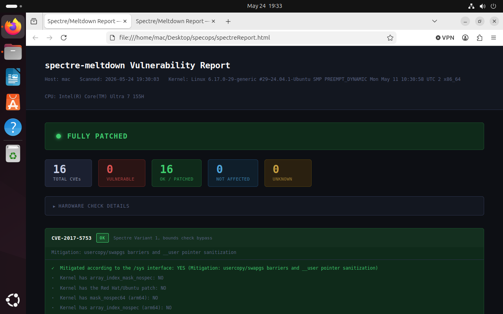

# spectre-report

HTML report generator for [spectre-meltdown-checker](https://github.com/speed47/spectre-meltdown-checker).

Turns the verbose CLI output into a clean, scannable HTML report with status badges,
per-CVE mitigation detail, reason text, and a summary table. No hardcoded data:
everything in the report comes from your scan.



## Requirements

- Python 3.10+

- No third-party dependencies (stdlib only)

- `spectre-meltdown-checker` in PATH (if using `--run`)

## Installation

```
# Install the checker via apt (recommended on Debian/Ubuntu)
sudo apt install spectre-meltdown-checker

# Or get it directly from upstream
curl -L https://meltdown.ovh -o spectre-meltdown-checker.sh

chmod +x spectre-meltdown-checker.sh

sudo mv spectre-meltdown-checker.sh /usr/local/bin/spectre-meltdown-checker
```

## Usage

### Capture output first, then report (recommended)

```
sudo spectre-meltdown-checker --no-color > checker_output.txt

python3 spectreReport.py --input checker_output.txt --output spectreReport.html

xdg-open spectreReport.html # Optional, you can open it on the browser
```

### Pipe directly

```
sudo spectre-meltdown-checker --no-color | python3 spectreReport.py --output spectreReport.html
```

### Let the script run the checker (requires root)

```
sudo python3 spectreReport.py --run --output spectreReport.html
```

## Report sections

- **Header**: hostname, scan time, kernel version, CPU model, and checker version extracted directly from the scan output

- **Overall status banner**: FULLY PATCHED or N VULNERABLE with a pulsing indicator

- **Stats bar**: totals across VULNERABLE / OK / NOT AFFECTED / UNKNOWN

- **Hardware check**: collapsible section with raw hardware capability lines

- **CVE cards**: one card per CVE showing the CVE ID, alias name, status badge, reason text, and mitigation detail lines (green = good, red = bad, grey = info)

- **Summary table**: the checker's compact summary line rendered as a two-column table

## Output

Self-contained HTML with all CSS inline. No external dependencies. Can be opened locally, attached to a ticket, or served over HTTP.

## Notes

- The checker requires root to read `/proc` and kernel config accurately. The report generator does not require root.

- Use `--no-color` when capturing output. The parser strips ANSI codes anyway but clean input avoids edge cases.

- All content in the report is parsed from your scan. No data is hardcoded.

## Integration ideas

- Add to a CI pipeline or cron job alongside your SBOM/grype/Trivy scan

- Compare reports across kernel upgrades to track mitigation progress

- Archive reports per host for compliance or audit purposes

## License

Distributed under the MIT License. See [LICENSE](LICENSE).